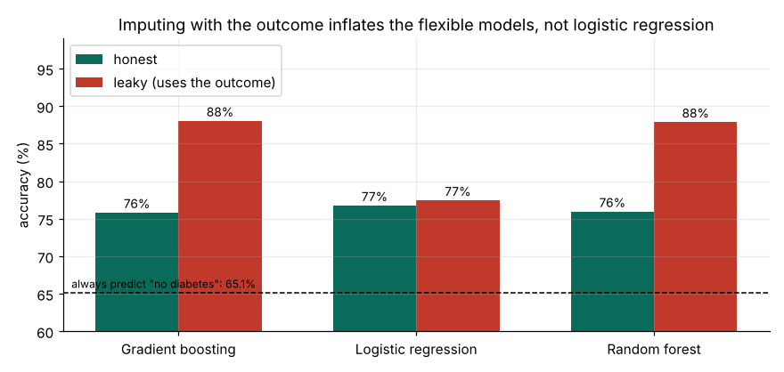

# Diabetes risk prediction: how much does a data leak flatter the model?

**Pima Indians diabetes data (768 women), repeated cross-validation and a screening cut-off analysis.**

The first version of this project filled in missing measurements with the median of each *outcome* group, which feeds the answer into the inputs. That made random forest and gradient boosting look like 88% accurate models. Imputing correctly, inside each cross-validation fold and without the outcome, the same models score **76%**, and plain logistic regression does as well (77%).

**Tools:** Python · pandas · scikit-learn · matplotlib

📓 **Full analysis:** [`notebooks/diabetes_risk_prediction.ipynb`](notebooks/diabetes_risk_prediction.ipynb) (also as [HTML](diabetes_risk_prediction.html))

## Key findings

| # | Finding | Evidence |
|---|---|---|
| 1 | Outcome-based imputation inflates flexible models by 12 points. | Random forest 76% → 88%, gradient boosting 76% → 88% (AUC 0.83 → 0.94-0.95); logistic regression 77% → 78%. |
| 2 | A simple logistic regression is as good as the complex models. | 76-77% accuracy and AUC 0.83-0.84 for all three; baseline 65.1%; SD about 3 points over 25 folds. |
| 3 | Glucose is the dominant predictor. | Shuffling glucose costs 0.19 AUC, BMI 0.06, pregnancies 0.02, everything else under 0.02. |
| 4 | At the default cut-off the model misses 43% of diabetic cases. | Sensitivity 57% at 0.5; lowering the cut-off to 0.3 gives 78% sensitivity but flags 45% of women (precision 60%). |



## Method

1. **Data audit.** Zeros in glucose, blood pressure, skin thickness, insulin and BMI are missing values coded as 0, so they are converted to missing.
2. **Leak comparison.** Same models and the same 25 cross-validation folds, once with outcome-based imputation and once with imputation inside the pipeline.
3. **Final model and importance.** Logistic regression; permutation importance on held-out folds.
4. **Screening trade-off.** Sensitivity, specificity and precision at different cut-offs from out-of-fold probabilities.

## Repository structure

```
├── data/pima_diabetes.csv
├── notebooks/diabetes_risk_prediction.ipynb
├── results/          # CSV tables written by the notebook
├── figures/
├── diabetes_risk_prediction.html
└── requirements.txt
```

## Reproduce

```bash
pip install -r requirements.txt
cd notebooks && jupyter notebook diabetes_risk_prediction.ipynb   # Run All (about a minute)
```

## Limitations

768 women of Pima Indian heritage aged 21 and over; not validated for other groups. A third of insulin and skin-thickness readings are missing. Teaching dataset, not a clinical tool.

## Author

Timothy Rimu
